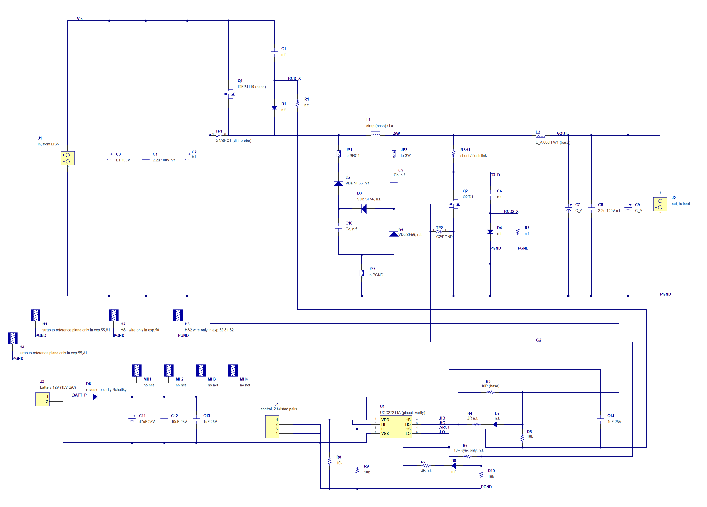
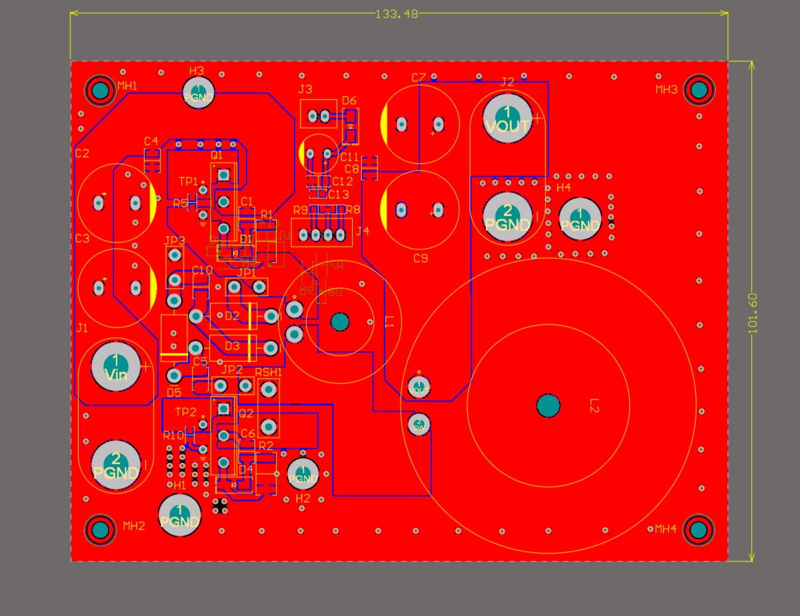
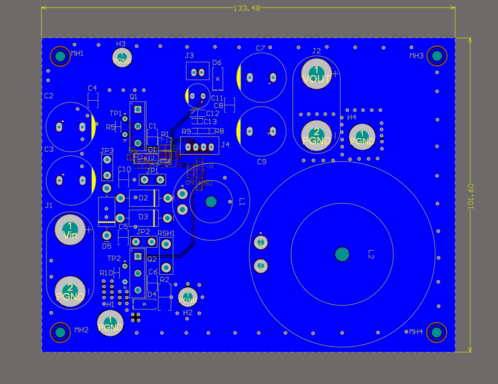
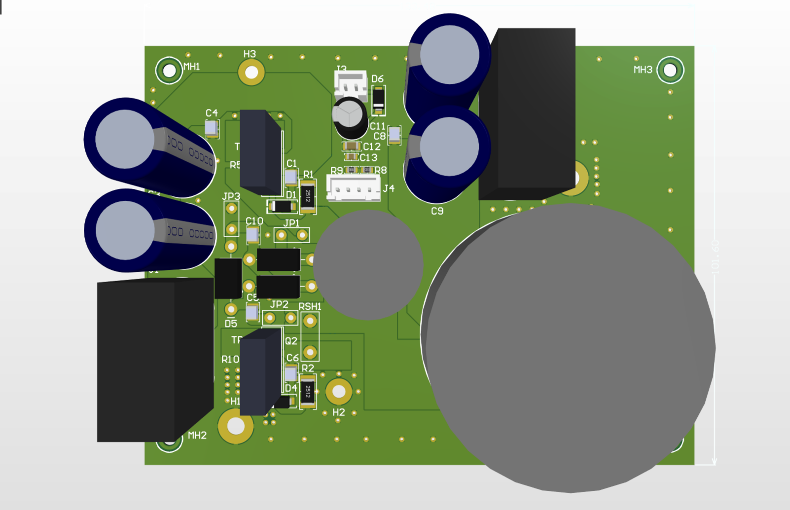
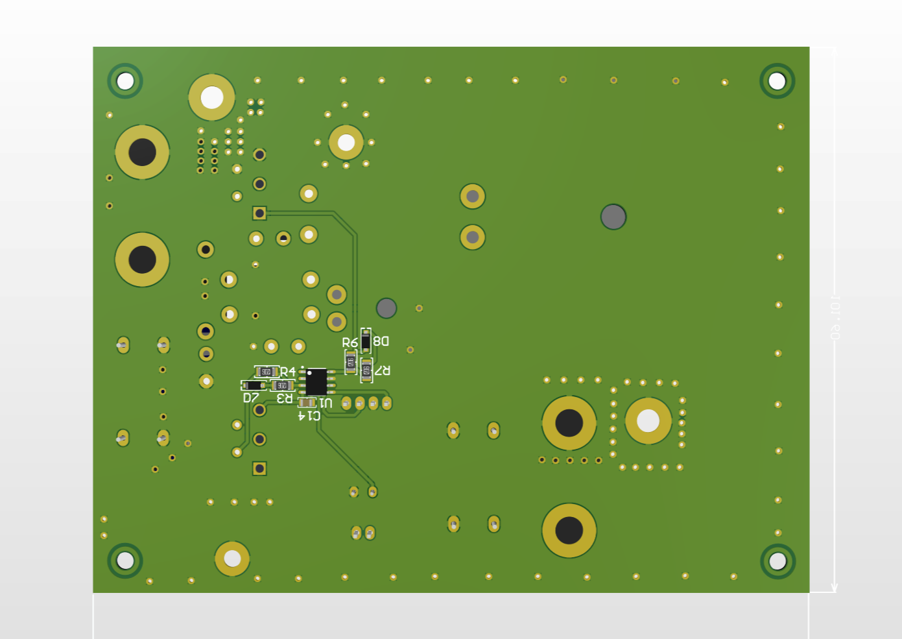
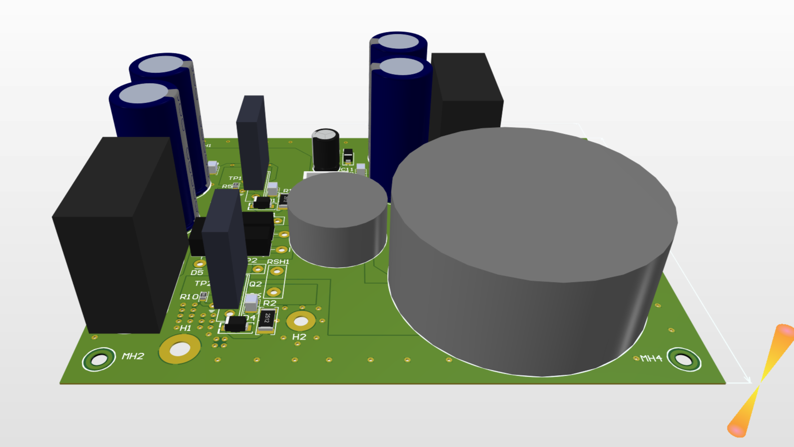

# Cell board: schematic and layout

Stage opened 2026-10-15. This folder closes task B1 of [bench earthing and first test](../2026-10-02-bench-earthing-and-first-test/) for the cell board: the schematic, the layout and the reasons behind both. The board is designed and passes its design rule check; it is not built yet. The flyback board is not part of this stage.

## What the board is for

The cell board is one half-bridge that is run in both directions on the same copper:

| Mode | Source | Load | Switch | Rectifier |
|---|---|---|---|---|
| Buck | through the LISN at J1 (24 V) | electronic load at J2 (12 V) | Q1 | Q2/D1 position: diode, or Q2 in synchronous mode |
| Boost | through the LISN at J2 (12 V) | electronic load at J1, constant-resistance mode (24 V) | Q2 | Q1 position: diode, or Q1 in synchronous mode |

Nothing on the board moves between the modes; only the source, the load and the control change. The buses keep their voltages (J1 side 24 V, J2 side 12 V), the inductor current is the same (3 A baseline, 1–8 A in the series), so every capacitor and semiconductor sees the same current stress in both modes and only the direction differs.

The board is built twice: once on a perfboard with no layout care, once as the printed board shown here, laid out by the rules below. The same physical change — a snubber, a different diode, an inductor winding, a heatsink to board minus, a strap to the reference plane — is then compared across four rows: buck and boost, perfboard and PCB. Buck against boost shows the direction of power flow; perfboard against PCB shows the layout. That is the whole point of the design: not a good converter, but a converter whose every variable can be changed one at a time while the rest stays fixed.

## What is on the schematic

Designators are those of the current sheet.

- **Power stage.** Q1 (TO-247, IRFP4110 in the baseline) and the shared Q2/D1 position (TO-247; a MOSFET or a diode, pin 2 = drain or cathode). L2 is the main inductor, a toroid, 68 µH in the baseline, with alternative windings. L1 is a second toroid position between the Q1 source and the switch node: a copper strap in the baseline, the passive-cell inductor La in the passive-cell experiments. RSH1 is a current-shunt position in the Q2/D1 drain, the same part in every experiment.
- **Buses.** Two 100 V electrolytics per side (C2, C3 at J1; C7, C9 at J2) and a 1210 ceramic place on each side (C4, C8), fitted only in the experiments that ask for it.
- **Snubbers.** One RCD cell per transistor: C1, D1, R1 across Q1; C6, D4, R2 across Q2. The same cell with its diode not fitted is the RC snubber, so there are no separate RC parts. The passive snubber cell of the 2017 paper (D2, D3, D5, C5, C10, La) sits between the Q1 source, the switch node and board minus, with link pads JP1–JP3; it is a buck-only experiment.
- **Gate drive.** UCC27211A (U1) with bootstrap, fed from a 12 V battery pack at J3 (15 V for SiC parts) through a reverse-polarity Schottky. Gate resistors R3 (Q1) and R6 (Q2), separate turn-off paths R4 + D7 and R7 + D8, pull-downs R5, R10 at the gates and R8, R9 at the logic inputs. Control comes in at J4 as two twisted pairs from a battery-powered STM32 box; the cable ground lands at the driver's VSS pin.
- **Test points.** TP1 across gate–source of Q1 (differential or floating probe), TP2 across gate–source of Q2. Bus ripple is taken with the probe spring directly on the capacitor leads; the switch-node waveform is taken on the RSH1 pad and the Q2 source pin.
- **Holes.** H1 and H4 are plated M4 holes on board minus next to the J1 and J2 minus posts: in three experiments board minus is strapped to the reference plane, from the hole on the LISN side (H1 in buck, H4 in boost), with a wide flat strap laid on the plane. H2 and H3 are plated M3 holes on board minus for the heatsink wires of Q2 and Q1. MH1–MH4 are mounting holes with no net; the board stands on insulating spacers 50 mm above the plane.

## How the board is laid out, and why

The board is two-layer, 133.5 × 101.6 mm, 1.6 mm, 70 µm copper.

**The bottom layer is a solid board minus, and it faces the reference plane.** In the test set-up the board hangs 50 mm above the plane, so the bottom copper is what the plane sees. A solid minus there shields everything on top from the plane; what is on the bottom is seen directly. Hence the rule that decides every placement: on the bottom only parts that sit on board minus or on a quiet potential; everything that moves with the switch node is on top, above the shield. The bottom carries the driver U1 and its small-signal network; the power parts, both snubber cells, the passive cell and the gate network of Q1 are on top. The one deviation is the driver's high side (bootstrap capacitor C14, R3, R4, D7), which moves with the Q1 source and sits on the bottom next to the driver; it is a square centimetre and was accepted.

**The hot loop runs on top, directly over the unbroken bottom minus.** In both modes the pulsed current goes bus ceramic → Q1 → L1 position → switch node → RSH1 → Q2/D1 → board minus → back. Its return is in the plane under the top copper, so the loop inductance is set by the 1.6 mm height, not by the length of the path. That is what allows the next decision.

**Q1 and Q2/D1 are about 50 mm apart on purpose.** On a converter meant for a product they would be as close as the packages allow. Here each of them is re-soldered dozens of times through the series (four MOSFET types, four diode types, SiC parts), each carries a heatsink that is fitted, removed, grounded, or shared with the other, and each must be reachable with a probe spring on the bench. Access and repeatability of the measurement were put ahead of the last nanohenry; the solid plane under the path is the compensation.

**Copper on the switching nodes is the minimum that carries the current**: the pads and the shortest connection between the Q1 source, the L1 position, RSH1, the Q2/D1 drain and L2. It is on top only and kept away from the board edges.

**Free area on top is a second minus pour, stitched to the bottom with 113 vias** (1.27 / 0.7 mm): about every 10 mm along the edges, every 5 mm around the switch node and the shunt, and two or three at the Q2/D1 source, at the bus ceramic and at every hole and minus post. A via can only go where the top copper is also minus; inside the Vin or switch-node polygons it would be a short.

**Clearance is a rule per net, not a global number.** 30 mil (0.76 mm) for the nets that carry the bus voltage — Vin, the Q1 source, the switch node, the Q2 drain, Vout, the two RCD mid nodes — and 10 mil for everything else, including board minus. Board minus is deliberately left out of the wide rule: it runs through the driver area, and a wide clearance there would have forced the control tracks apart for no reason. Where control pins land on a power net (the driver's HS pin on the Q1 source, the bootstrap capacitor, the gate pull-down) a third rule gives 10 mil for those parts only: those nets float together with the source, there is no voltage between them.

**Polygon connections**: thermal relief with four 1 mm spokes for every soldered part, so a TO-247 pin in two minus pours can still be heated with an iron; direct connection for vias and for the bolted holes and posts, which are never soldered.

## What each rule is expected to do to the spectrum

These are expectations, written before anything is measured; the perfboard-against-PCB rows of the series are what tests them.

1. **Switching copper area.** The switch node, the Q1 source and the Q2 drain swing by the full bus voltage at every edge. Their copper has a capacitance to the reference plane, and that capacitance carries a common-mode current which returns through the LISN. Less area, and area kept away from the board edges, is expected to lower the common-mode part of the spectrum, mostly in the upper decade (3–30 MHz).
2. **Solid bottom minus.** With the minus pour between the switching copper and the plane, the plane sees quiet copper, and the capacitance from the switch node is returned to board minus instead of to the plane. The main difference between the PCB and the perfboard is expected in the common-mode component, not in the differential one.
3. **Return under the path.** The pulsed current of the hot loop returns in the plane directly under the top copper; the loop area is the path length times the board thickness, not the area a perfboard wire makes. Lower loop inductance means less ringing on the switching edges and a lower differential-mode level at 10–30 MHz, where the ringing sits.
4. **Stitching vias.** Without them the top minus pour would be a separate sheet of copper joined to the bottom only through the through-hole pins: at high frequency it resonates and radiates, and its potential is not the plane's. The vias make the two pours one plane. The ring of vias around the switch node closes the displacement current from the switching copper into the plane next to its source, instead of letting it find a path across the board.
5. **Clearance rules.** The 30 mil rule is about the 60 V on the bus, not about emission; it is listed with the layout only so that nobody looks for a hidden reason.

What is not expected to change between the two builds: the differential-mode component below 1 MHz, which is set by the bus capacitors and the inductor, and the gate waveforms, which are set by the driver and the gate resistors.

## What was checked, what remains

Design rule check: no electrical violations (clearance, short circuit, unrouted) and no hole-size violations; five silkscreen items remain that are cosmetic (outlines on pads, which the fab clips). The driver pinout and the TO-247 footprint were checked against the datasheets. Before ordering: the diameter and lead pitch of the electrolytic cans and the stud of the binding posts are confirmed on the parts in hand. The order is five boards; two or three are expected to be used up by the re-soldering over the series.

## What comes next

The perfboard copy is built from the same part list and photographed before its first measurement. The experiment plan — the same numbered changes in four series, with the prediction written before each run — is published with the first measurements.

The Altium project and the parts library are kept locally; this folder holds the schematic and the board as images.
